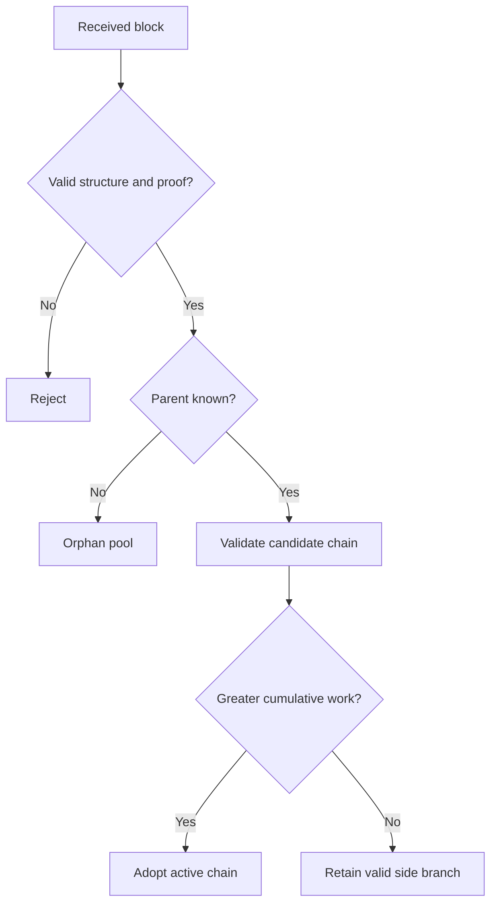

# Architecture and consensus

QChain is a Python account-based blockchain. It is not a UTXO implementation.
The protocol tracks integer QCOIN balances and confirmed nonces by address.

## Transactions and wallets

A transfer contains `sender` (the Ed25519 public key as 64 lowercase hex
characters), `receiver` (a 40-character address), `amount`, `nonce`, `fee`, and
`signature` (128 lowercase hex characters). The address is the first 40 hex
characters of SHA3-256 of the public key's hex text.

Amounts and nonces are positive integers; fees are nonnegative integers. The
maximum encoded integer is `2**63 - 1`. Booleans, floating-point values, NaN,
malformed addresses, and invalid signatures are rejected. A receiver does not
need an existing wallet file on the node. The first sender nonce is 1.

The signature covers sorted compact JSON of the five payload fields. The
transaction identifier hashes the normalized transaction including its
signature. Transfers debit amount plus fee, credit the receiver's amount, and
advance the sender's nonce. Every nonce must follow its predecessor exactly.

Wallets encrypt the private key with Fernet, using PBKDF2-HMAC-SHA256 with a
random 16-byte salt and 390,000 iterations. Loading checks that the private key,
public key, and address agree. Password changes re-encrypt the same key; the
address stays unchanged. This is classical Ed25519, not post-quantum cryptography.

## Blocks and Proof of Work

A header commits to `index`, `previous_hash`, `merkle_root`, `difficulty`,
`timestamp`, and mining `nonce`. Its SHA3-256 hash must have `difficulty` leading
zero hexadecimal digits. A Merkle tree commits to the ordered transaction JSON;
odd-sized layers duplicate their last leaf. The empty tree hashes empty bytes.

Genesis has index 0, previous hash `"0"`, timestamp `0.0`, no transactions, and
a deterministically mined nonce. The configured initial difficulty determines
its hash. Candidate chains must share the local genesis.

Every non-genesis block starts with exactly one unsigned `COINBASE` transaction.
Its nonce is the block index, its fee is zero, and its amount is the configured
reward (default **50 QCOIN**) plus all included transfer fees. There is no reward
halving or coinbase maturity rule in this prototype.

Validation checks header types, hash, Proof of Work, Merkle commitment, linkage,
height, expected difficulty, transaction signatures, balances, and nonces.
Timestamps cannot go backwards from the parent or exceed the validating node's
current clock by more than 120 seconds. Nodes need reasonably synchronized clocks.
A block may contain at most 1,000 transactions including its coinbase.

## Difficulty and chain selection

Defaults are difficulty 4, target block time 10 seconds, retarget interval
5 blocks, and difficulty bounds 1–8. At the first retarget (block 6), the node
compares the timestamps of blocks 1 and 5 against a 40-second target window.
Subsequent retargets use the corresponding previous five-block window.

If the elapsed time is less than half the target, difficulty rises by one; if
it is more than twice the target, difficulty falls by one. Otherwise it stays
the same. Bounds apply to every adjustment. This coarse educational rule can
make repeated instant local mining progressively slower.

Block work is `16 ** difficulty`; cumulative work sums it over the chain,
including genesis. A valid candidate replaces the active chain only when its
work is strictly greater. Equal-work ties preserve the local tip until a branch
gains more work. A longer chain is not necessarily a heavier chain.

## Mempool and reorganizations

The mempool accepts at most 1,000 pending transfers. Admission validates against
the confirmed state plus earlier pending transfers. Mining prefers higher fees
while respecting balance and nonce dependencies; `max_transactions` limits the
number of regular transfers, from 0 through 999.

Blocks with unknown parents enter a bounded orphan pool (100 blocks). Connected,
validated competing blocks enter a bounded side-branch pool (200 blocks). The
active chain, these pools, and the transaction index are stored independently.

After a reorganization, QChain rebuilds balances and nonces. It combines
unconfirmed transfers from disconnected blocks with the existing mempool,
removes duplicates and newly confirmed transfers, and retries remaining
transactions until no more dependencies can be satisfied. Coinbase rewards
are never recovered. Losing main-chain blocks remain attachable side branches
within the pool limit. The transaction index and confirmation counts reflect
the new active chain. A bounded persistent journal records actual fork switches;
ordinary synchronization that only extends the tip is not a reorganization.

## Networking and concurrent requests

Peers are configured through `POST /peers`. Discovery imports at most 32 entries
from each currently known peer, deduplicates normalized URLs, rejects self URLs,
and caps the local peer set at 32. Discovery and synchronization are explicit
operations; there is no background scheduler or automatic public bootstrap.
Inbound broadcast `source` fields only prevent echoing back to the sender; they
do not register new peers.

Synchronization ranks peers by advertised work, checks headers, identifies a
common ancestor, downloads missing blocks, then validates the entire candidate
locally. Invalid downloads do not enter the block index. Peer status is a hint,
not evidence that a chain is valid.

A per-node reentrant lock serializes access to state and files within one
process. Outbound HTTP releases that lock so a peer can call back without a
circular wait. Sync snapshots the common prefix before downloading and checks
candidate work again before adoption. Mining holds the local lock, so long
Proof-of-Work searches can delay other local requests. Independent processes
must not share a writable data directory.
